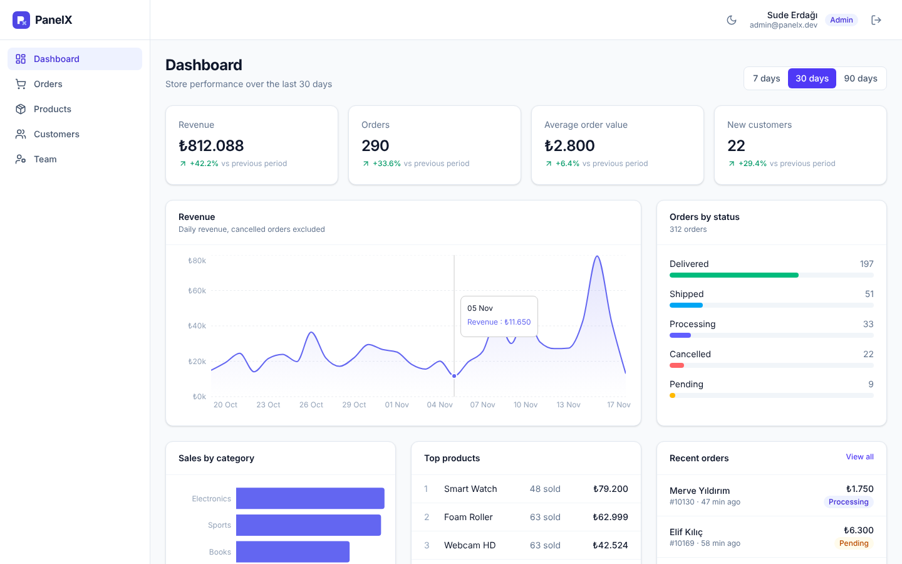
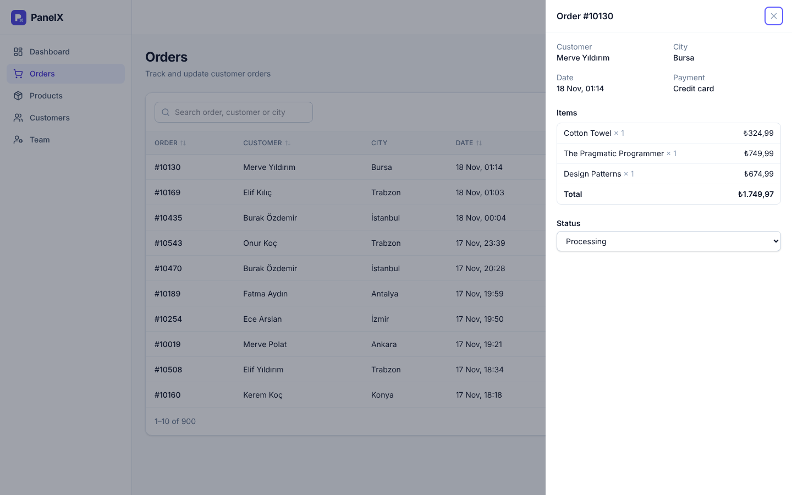
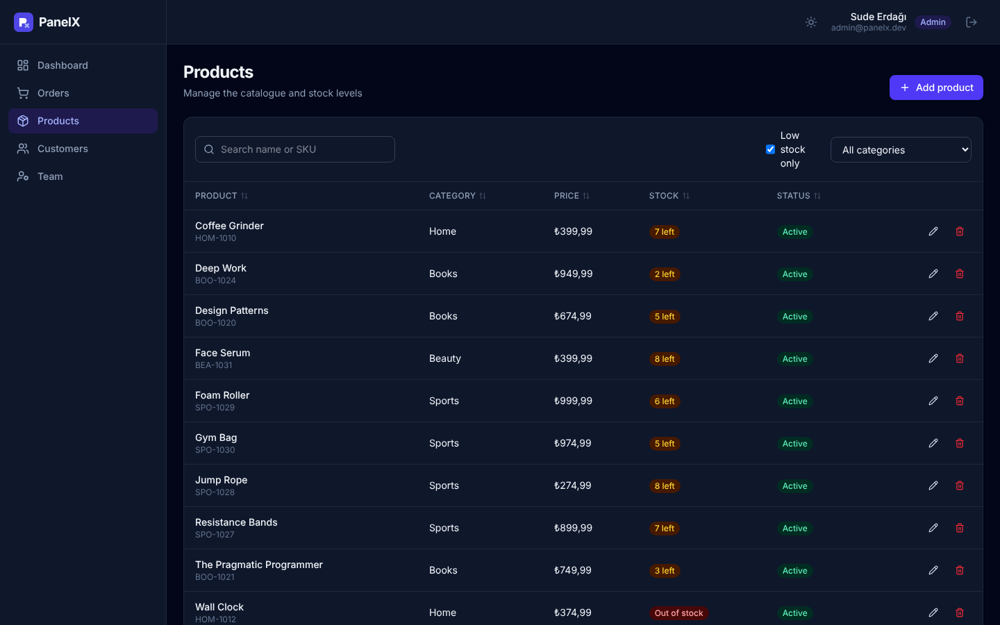

# PanelX Admin

Admin dashboard for an online store. Store staff can follow sales on the dashboard, manage orders and products, look up customers and control who on the team can do what.

**Live demo:** https://suderdagi.github.io/panelx-admin/ (password for every demo account: `demo1234`)



## Features

- **Dashboard:** revenue, orders, average order value and new customers with change vs. the previous period; revenue chart, sales by category, order status breakdown, top products. 7 / 30 / 90 day ranges.
- **Orders:** search, filter by status, sort, paginate, open an order to see its items and change its status
- **Products:** create and edit products with validated forms, low-stock filter, delete with confirmation
- **Customers:** searchable, sortable customer list
- **Team:** admins change other members' roles (with optimistic updates)
- **Role based access:** `admin`, `editor` and `viewer` see different actions; the API enforces the same rules
- **CSV export** of the filtered order list
- **Shareable views:** search, filters, sorting and page number live in the URL
- **Dark mode**, responsive layout, keyboard and screen reader friendly forms, dialogs and tables
- **Product analytics** with PostHog: typed events for the key actions, pageviews and user identification (off unless a key is configured)

| Orders | Products (dark mode) |
| --- | --- |
|  |  |

## Tech stack

| | |
| --- | --- |
| UI | React 19, TypeScript, Tailwind CSS 4, lucide-react |
| Data fetching | TanStack Query (caching, background refetch, optimistic updates) |
| Tables | TanStack Table (server-side sorting and pagination) |
| Charts | Recharts |
| Forms | React Hook Form + Zod |
| Routing | React Router 7 |
| Mock backend | Mock Service Worker (MSW) |
| Product analytics | PostHog (posthog-js, loaded lazily) |
| Tests | Vitest, Testing Library |
| Build / deploy | Vite, GitHub Actions, GitHub Pages |

## Roles

| Action | Admin | Editor | Viewer |
| --- | :-: | :-: | :-: |
| View dashboard, orders, products, customers | ✓ | ✓ | ✓ |
| Change order status | ✓ | ✓ | |
| Create and edit products | ✓ | ✓ | |
| Export CSV | ✓ | ✓ | |
| Delete products | ✓ | | |
| Manage team roles | ✓ | | |

The rules are defined once in [`src/auth/permissions.ts`](src/auth/permissions.ts). The UI uses them to hide or disable actions, and the mock API uses them to answer with `403`, the way a real backend would. Hiding a button is only a convenience; the server check is what actually protects the data.

## How the mock API works

There is no separate backend. [MSW](https://mswjs.io) runs a service worker that intercepts `fetch('/api/...')` calls in the browser and answers them from an in-memory database ([`src/mocks`](src/mocks)):

- Data is generated with Faker using a fixed seed, so it is the same on every load; dates are relative to today, so the dashboard always shows recent activity.
- Handlers check the token, apply role permissions, validate input with the same Zod schema as the form, filter / sort / paginate on the "server" and return proper status codes (`400`, `401`, `403`, `404`, `409`).
- The frontend only talks to `src/api/endpoints.ts`. Pointing it at a real REST API would not require changes in the pages.

The same handlers run in Node during tests, so tests exercise real HTTP requests instead of mocked functions.

## Product analytics

The app sends product events to [PostHog](https://posthog.com) so I can see how the dashboard is actually used: which features people reach, where a flow is dropped, and whether a change improved anything.

**What is tracked.** Every event and its properties are declared once in [`src/analytics/analytics.ts`](src/analytics/analytics.ts). `track()` is typed against that list, so a misspelled event name or a missing property doesn't compile.

| Event | Properties | Question it answers |
| --- | --- | --- |
| `logged_in` / `logged_out` | `role` | How many people use the panel, and with which roles? |
| `$pageview` | path | Which screens are used, and which are never opened? |
| `dashboard_range_changed` | `days` | Is the 30-day default the right one? |
| `order_opened` → `order_status_changed` | `status`, `from`, `to` | Funnel: how many opened orders actually get processed? |
| `orders_exported` | `rows`, `status_filter` | Who still needs data outside the panel, and why? |
| `product_created` / `product_updated` / `product_deleted` | `category` | How is the catalog maintained? |
| `team_role_changed` | `to` | Is role management used at all? |

**Privacy choices.** Users are identified by id and role only, never by name or email. Pageviews send the path without the query string, so search terms typed by staff are not collected. posthog-js also attaches the full page address to every event on its own, so a `before_send` hook (`scrubEvent`) trims every address to its path before anything is sent. Autocapture and session recording are off, and so are the PostHog features this app doesn't use (feature flags, surveys, exception capture, web vitals, heatmaps, dead clicks): only the events above are sent, which also keeps the data clean enough to build funnels on.

**Turning it on.** Analytics is a no-op without a key, so local development, tests and forks send nothing. Set `VITE_POSTHOG_KEY` (see [`.env.example`](.env.example)) locally, or the `POSTHOG_KEY` repository variable for the GitHub Pages build. The SDK is loaded with a dynamic `import()`, so it isn't in the initial bundle, and when no key is set at build time it isn't bundled at all.

**Testing it.** The analytics module sends events to a replaceable sink. Tests plug in a recording sink and check, through the real UI, that a login identifies the user without personal data, that pageviews never contain the query string, and that an order status change is sent with its old and new status. A second test runs the real posthog-js SDK with the app's settings on a page like `/orders?search=...` and checks that nothing it would send contains the query string.

## Project structure

```
src/
├── analytics/      # typed PostHog events, pageview tracking
├── api/            # fetch wrapper, typed endpoints, shared types
├── auth/           # auth context, route guards, permission table
├── components/     # layout, DataTable, SearchInput, small UI kit (Button, Modal, Field…)
├── hooks/          # URL-synced list params, debounce, theme
├── lib/            # formatting, CSV export, Zod schemas
├── mocks/          # MSW handlers, seeded data, dashboard aggregation
├── pages/          # one file per screen
└── test/           # test setup and render helper
```

## Getting started

```bash
npm install
npm run dev        # http://localhost:5173
npm test           # unit + integration tests
npm run build
```

## Tests

- **Unit:** permissions, CSV escaping (including spreadsheet formula injection), product validation, dashboard aggregation, that chart days are labelled correctly in any time zone, and search that ignores case and Turkish accents
- **Integration:** the whole app is rendered with Testing Library against the MSW handlers: login and redirect back to the requested page, order filtering and search (including the search box following the address), status changes, product form validation and creation, expired sessions, rollback of a failed optimistic update, opening an order from the keyboard, what each role can and cannot do, and which analytics events are sent (and that they contain no personal data)

CI runs lint, type check and tests on every push; a second workflow deploys `main` to GitHub Pages.
